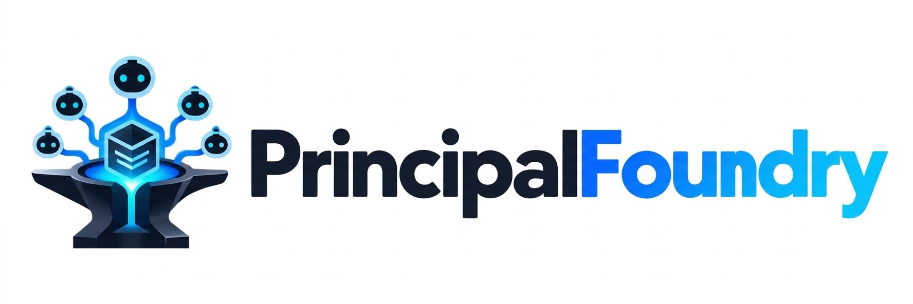

<p align="center">
  
</p>

<p align="center">
  <strong>Git-native software factories for orchestrator-led agentic engineering teams.</strong>
</p>

PrincipalFoundry is a Git-native framework and bootstrap CLI for orchestrator-led agentic engineering.

A small number of senior engineers operate increasingly in orchestrator mode: they define intent, product direction, architecture, constraints, and quality standards while coding agents perform most implementation, testing, verification, and routine review inside an engineered harness.

PrincipalFoundry targets the disciplined end of AI-assisted software development: **agentic engineering rather than vibe coding**. Agents are given bounded goals, structured context, architectural constraints, verification gates, and explicit feedback loops instead of being asked to generate software from loosely specified prompts.

The CLI executable is `pfoundry`.

## The team model

Traditional software delivery spreads product, architecture, implementation, QA, and operations across many specialized roles. PrincipalFoundry explores a different model: one or two senior engineers retain product and engineering judgment while operating as **orchestrators**. They define goals, make architectural trade-offs, set quality standards, and evaluate results rather than manually producing most implementation.

The architect agent supports the orchestrator by maintaining product and architecture context, decomposing approved direction into bounded work, and reviewing execution evidence. Coding, tester, reviewer, and automation agents operate underneath that layer.

<p align="center">
  
</p>

The human core stays intentionally small. The software factory is the execution system around it: the architect agent and execution agents work in a Git-native feedback loop, returning implementation evidence to the senior engineer instead of replacing senior engineering judgment.

## Agentic engineering model

PrincipalFoundry combines three ideas: **human orchestration**, **harness engineering**, and a **Git-native software factory**.

- Human orchestration defines who directs the system: senior engineers own intent, trade-offs, architecture, and final judgment.
- Harness engineering defines what informs and constrains agents: specifications, context, tools, guardrails, verification, and feedback.
- The software factory defines how bounded implementation work is repeatedly produced, tested, reviewed, and accepted.

PrincipalFoundry separates architectural judgment from implementation throughput.

```text
Senior engineer / orchestrator
      ↕
Architect / planning agent
      │
      ├── product requirements
      ├── architecture
      ├── architecture decisions
      ├── task decomposition
      └── final implementation review
      │
      ▼
Git repository
      │
      ▼
Coding / implementation agent ◄──────────────────────┐
      │                                              │
      ├── impact analysis                            │
      ├── coding                                     │
      ├── targeted tests                             │
      ├── integration verification                   │
      └── implementation evidence                    │
      │                                              │
      ├──────────────┐                               │
      ▼              ▼                               │
 Tester agent    Reviewer agent                      │
      │              │                               │
      └──────┬───────┘                               │
             ▼                                       │
 deterministic verification                         │
             │                                       │
             ▼                                       │
       Architect review                              │
             │                                       │
       accept / revise                               │
             │                                       │
             ▼                                       │
        next small task ─────────────────────────────┘
```

Git is the shared state, handoff mechanism, and audit trail between the architect and execution side.

## Harness engineering

PrincipalFoundry is not a coding model and it is not a replacement for tools such as OpenCode, Codex, or Claude Code. Those tools are execution engines. PrincipalFoundry standardizes the engineering harness around them.

The harness consists of:

```text
Specifications and engineered context
├── docs/PRODUCT_SPEC.md
├── docs/ARCHITECTURE.md
├── docs/OPEN_QUESTIONS.md
└── docs/decisions/

Static context and guardrails
└── AGENTS.md

Durable orchestration state
├── .factory/FACTORY_STATE.md
├── .factory/MILESTONE.md (one demonstrable outcome, architect-owned)
└── .factory/CURRENT_TASK.md

Agent execution
├── coding / implementation agent
├── tester agent
└── reviewer agent

Feedback and evidence
├── .factory/IMPLEMENTATION_REPORT.md
├── .factory/TESTER_REPORT.md
├── .factory/INTERNAL_REVIEW.md
└── .factory/VERIFICATION_REPORT.md

Control plane
└── Git
```

Discovery and design are therefore not merely planning steps. They are **context engineering**: turning human intent into structured product, architecture, decision, and constraint context that coding agents can reliably act upon.

The design package is the initial engineered context for the software factory. The agent contracts, task protocol, verification gates, and evidence files form the execution harness around that context.

## Starting a new project

The intended onboarding flow starts with **product and architecture discovery before the software repository is bootstrapped**.

The software factory should begin from an approved design baseline, not from an empty repository where implementation agents are expected to discover fundamental product and architecture decisions themselves.

### 1. Start the architect discovery session

Begin with a strong architect model and the senior engineer acting as orchestrator.

Use the neutral kickoff prompt in:

```text
docs/prompts/discovery-kickoff.md
```

The prompt instructs the architect to act as a senior software architect and technical product owner, work iteratively with the user, challenge assumptions, clarify the most important product and architecture questions, and avoid implementation work during this phase.

The planned CLI experience is:

```bash
pfoundry start my-project \
  --architect chatgpt \
  --executor opencode
```

`pfoundry start` will print the kickoff prompt and the expected output package. This command is not implemented yet; today the prompt can be copied directly from `docs/prompts/discovery-kickoff.md`.

### 2. Run discovery iteratively

The architect and senior engineer/orchestrator work conversationally until the important product and architecture uncertainties are sufficiently clear.

The architect should explore the areas that materially affect the system, including:

- product goal and target users;
- core workflows and first-version scope;
- explicit non-goals;
- business and technical constraints;
- scale, reliability, performance, security, and privacy requirements;
- external integrations;
- deployment environment;
- major technology constraints or preferences;
- system boundaries and data ownership;
- unresolved decisions.

This is deliberately not a one-shot questionnaire. The architect should use each answer to determine the next highest-value questions and actively provide recommendations and trade-offs.

### 3. Approve the initial design baseline

When the architect believes the initial design is sufficiently clear, it summarizes the proposed baseline and remaining uncertainties.

The senior engineer/orchestrator explicitly approves or corrects that baseline before the final design package is produced.

No implementation task should exist yet.

### 4. Produce the design package

After approval, the architect produces:

```text
design-package/
├── PROJECT_BRIEF.md
├── PRODUCT_SPEC.md
├── ARCHITECTURE.md
├── OPEN_QUESTIONS.md
└── decisions/
    ├── INDEX.md
    └── ADR-*.md
```

ADRs are created only for material architectural decisions that were actually discussed and approved. Open or intentionally deferred decisions remain in `OPEN_QUESTIONS.md`.

This package is the handoff between the discovery/design phase and the software factory.

During repository bootstrap, the files map into the repository as follows:

```text
PROJECT_BRIEF.md        → .factory/PROJECT_BRIEF.md
PRODUCT_SPEC.md         → docs/PRODUCT_SPEC.md
ARCHITECTURE.md         → docs/ARCHITECTURE.md
OPEN_QUESTIONS.md       → docs/OPEN_QUESTIONS.md
decisions/*             → docs/decisions/*
```

The project brief remains bootstrap/orientation context, while product, architecture, open questions, and ADRs become durable design knowledge.

### 5. Initialize the project repository from the approved design

The repository bootstrap command is:

```bash
pfoundry init my-project \
  --from ./design-package \
  --architect chatgpt \
  --executor opencode \
  [--task ./design-package/implementation/TASK-0001.md]
```

The behavior is:

```text
validate design package
        ↓
create repository structure
        ↓
install approved product + architecture documents
        ↓
create .factory/ control files
        ↓
create AGENTS.md
        ↓
create executor-specific tester/reviewer agents
        ↓
git init
        ↓
bootstrap commit on main
```

The repository is therefore created from an already-understood product and architecture baseline.

`pfoundry init --from` validates the design package (requiring `PROJECT_BRIEF.md`, `PRODUCT_SPEC.md`, `ARCHITECTURE.md`, `OPEN_QUESTIONS.md`, and `decisions/INDEX.md`), installs the approved documents into `docs/` and `.factory/`, generates the repository skeleton, and creates the bootstrap commit on `main`. The design package's `decisions/*` records are copied into `docs/decisions/*`.

With `--task`, the given implementation task is installed as the active `.factory/CURRENT_TASK.md` (with `status: READY`) and the factory phase advances to `SCAFFOLDING`. Without `--task`, the phase is recorded as `REPOSITORY_BOOTSTRAP` and the architect issues the first task from `.factory/CURRENT_TASK.md`.

The `pfoundry new` command still exists for starting a repository directly in `DISCOVERY`; `pfoundry init --from` implements the discovery-first flow described above.

### 6. Connect the remote repository

Remote creation stays separate from the local bootstrap so the workflow remains provider-independent.

After initialization, connect an empty GitHub, GitLab, or other Git remote:

```bash
git remote add origin REMOTE_URL
git push -u origin main
```

Do not initialize the remote with a README, `.gitignore`, or license when the local repository already contains the bootstrap commit.

The repository becomes the shared control plane:

```text
Git repository
   ├── senior engineer / architect agent
   └── selected executor
       ├── implementer
       ├── tester
       └── reviewer
```

### 7. Architect issues the first implementation task

Only after the approved design has been installed in the repository does the architect create the first bounded implementation task in:

```text
.factory/CURRENT_TASK.md
```

The first task should normally establish the minimum project scaffolding and verification harness required by the approved architecture.

A project should then evolve through small coherent increments:

```text
TASK-0001  project skeleton and build/test tooling
     ↓
TASK-0002  minimal runnable application
     ↓
TASK-0003  required persistence/infrastructure
     ↓
TASK-0004  first thin end-to-end product capability
     ↓
...
```

The architect should never issue a task equivalent to “implement the entire product”.

### 8. Run the implementation cycle manually

Before enabling automation, run the executor manually.

The coding / implementation agent follows `AGENTS.md` and processes exactly one active task.

Its cycle is:

```text
CURRENT_TASK
     ↓
read architecture/spec/ADRs
     ↓
impact analysis
     ↓
tester PREFLIGHT
     ↓
baseline tests
     ↓
implementation
     ↕
targeted test feedback
     ↓
required verification gates
     ↓
tester FINAL
     ↓
independent reviewer
     ↓
deterministic final verification
     ↓
factory evidence reports
```

The executor records evidence in:

```text
.factory/
├── IMPLEMENTATION_REPORT.md
├── TESTER_REPORT.md
├── INTERNAL_REVIEW.md
└── VERIFICATION_REPORT.md
```

### 9. Architect reviews the implementation

The architect reads the active task, implementation diff, implementation report, tester evidence, independent review, deterministic verification results, and relevant product and architecture documents.

It then chooses one of three outcomes:

```text
ACCEPT
  → close the current task
  → define the smallest useful next task

REQUEST REVISION
  → keep the same task id
  → increment the revision
  → incorporate blocking findings into CURRENT_TASK

BLOCK / ESCALATE
  → require senior-engineer product or architecture input
```

The architect should judge the actual code and evidence rather than trusting reports blindly.


## Architect / planning cycle

For a recurring architect job, render the repository-specific prompt directly from the CLI:

```bash
pfoundry prompt architect-loop \
  --repo https://github.com/owner/project
```

The command writes only the ready-to-use prompt to stdout. It substitutes the repository URL into the versioned template at `docs/prompts/architect-development-loop.md`, where the reusable template contains the placeholder `{{GITHUB_REPOSITORY_URL}}`.

This makes it suitable for copying into a scheduled ChatGPT Work task or piping into another automation without extra CLI status text.

Once a project is established, the architect loop is intentionally small and repeatable:

```text
current repository state
        +
PRODUCT_SPEC
        +
ARCHITECTURE / ADRs
        +
OPEN_QUESTIONS when relevant
        +
previous execution evidence
        ↓
review previous task
        ↓
accept / revise / escalate
        ↓
choose the smallest coherent next capability
        ↓
write exactly one CURRENT_TASK
        ↓
commit architect handoff
```

The architect is responsible for:

- product clarity;
- architecture;
- architecture decisions;
- task decomposition;
- task acceptance criteria;
- required verification gates;
- reviewing executor evidence;
- deciding whether work is accepted;
- choosing the next incremental task.

The architect should not normally perform the implementation itself, even if technically capable of editing the repository.

## Agent execution loop

The executor is the adapter to the selected coding-agent environment and is responsible for implementation throughput within architect-defined boundaries.

It may:

- inspect and understand the repository;
- choose local implementation details;
- implement the current task;
- create or update tests;
- invoke tester and reviewer agents;
- run builds and verification;
- update evidence files.

It may not independently:

- change product requirements;
- change acceptance criteria;
- change major architecture;
- introduce major infrastructure not authorized by the task;
- start another task;
- self-approve architecture changes.

If a task requires such a decision, the executor returns `ARCHITECT_DECISION_REQUIRED`.

## Autonomous executor gate

An autonomous loop separates three concerns:

```text
scheduler        owns WHEN to check
PrincipalFoundry owns WHETHER execution is allowed
the executor     owns IMPLEMENTATION
```

A scheduler (systemd timer, cron, or another orchestrator) only decides when to look at the repository. It must not decide whether work may run, and it must not invoke a coding agent on every tick. `pfoundry executor` is the deterministic gate between the schedule and the implementation agent.

### Checking state

```bash
pfoundry executor status
pfoundry executor status --json
```

`status` inspects the repository containing the current working directory and reports the effective executor state without changing anything or contacting the network. The JSON form is stable and suitable for scripting.

`--ignore-lock` reports the state as if no executor lock were held. It exists for supervisors that already hold the executor lock themselves (for example an architect gate) and must not self-report `ALREADY_RUNNING`.

| State | Meaning |
| --- | --- |
| `READY_TO_EXECUTE` | A READY task revision has no executor handoff yet and the factory phase permits autonomous execution. |
| `WAITING_ARCHITECT` | The executor already produced evidence for this task revision; the loop is waiting for architect review. |
| `NO_ACTIVE_TASK` | `CURRENT_TASK.md` is IDLE or absent. |
| `PAUSED` | The factory phase is `PAUSED`. |
| `BLOCKED_HUMAN` | The task, or the latest evidence, requires a human/architect decision. |
| `ALREADY_RUNNING` | Another executor cycle currently holds the repository lock. |
| `PHASE_BLOCKED` | The lifecycle phase does not permit autonomous execution. |
| `ERROR` | The repository is in an unsafe state (dirty worktree, divergent history, unreadable control files, or a failed executor handoff). |

### Running one cycle

```bash
pfoundry executor tick --executor opencode --attach http://127.0.0.1:4096

# pin the model explicitly
pfoundry executor tick --executor opencode --attach http://127.0.0.1:4096 \
  --model openrouter/deepseek/deepseek-v4.1-flash
```

`tick` performs one safe, idempotent cycle:

```text
acquire executor lock
      ↓
locate repository root
      ↓
require a clean worktree
      ↓
fetch the remote
      ↓
fast-forward the default branch only
      ↓
read FACTORY_STATE, CURRENT_TASK, and executor evidence
      ↓
decide the effective state
      ↓
invoke the executor only when READY_TO_EXECUTE
```

`--attach` points the executor at an already-running agent server (for example the existing OpenCode server on localhost). If it is omitted, the executor's normal non-attached mode is used. `--executor` defaults to the `executor` recorded in `.factory/FACTORY_STATE.md`.

`--model` selects the model the executor runs with, in OpenCode's `provider/model#variant` form (for example `openrouter/deepseek/deepseek-v4.1-flash` or `openrouter/anthropic/claude-sonnet-latest`). If it is omitted, the executor uses its own default model. Pinning the model explicitly keeps scheduled execution reproducible.

`--auto` auto-approves executor permissions that are not explicitly denied. Unattended runs generally need it, otherwise the executor can stall waiting for an interactive approval that never arrives.

After the executor exits, Git and the factory evidence remain authoritative: a zero exit code is not proof of completion. If the executor leaves an unsafe or incomplete state, the cycle reports `ERROR` rather than claiming success.

### A five-minute timer does not mean an LLM call every five minutes

The gate exits before invoking any agent unless the state is `READY_TO_EXECUTE`. Every other outcome is a cheap no-op that prints one concise line:

```text
NO_ACTION: waiting for architect review of TASK-0012 r1
NO_ACTION: factory phase SCAFFOLDING does not permit autonomous execution
```

No-work ticks create no commits and do not modify the repository.

### Task idempotency

Idempotency is keyed on the implementation task identity, `task_id + revision`, never on elapsed time:

- a READY task revision with no matching executor evidence is executable;
- once the executor records `.factory/IMPLEMENTATION_REPORT.md` evidence whose `task_id` and `revision` match the active task, the gate stops executing that revision and reports `WAITING_ARCHITECT`;
- an architect-issued higher `revision`, or a new `task_id`, is new executable work.

The executor evidence frontmatter (`task_id`, `revision`, `status`, `result_commit`) is what identifies the handoff; `AGENTS.md` defines the exact contract.

### Git is the synchronization boundary

The scheduler and the executor never coordinate directly. The architect commits and pushes a handoff; the executor `fetch`es, fast-forwards, and executes only committed state, then commits and pushes its own handoff. Only committed repository state exists from the executor's perspective. Git operations are conservative: the gate requires a clean worktree, synchronizes fast-forward-only, and never rebases, resets, force-pushes, or discards local work. If safe synchronization is impossible it reports `ERROR` and does not invoke the executor.

### Executor locking

Each cycle takes a lock in the repository's Git directory (never committed to Git). It prevents overlapping timer runs, a timer run during a manual tick, and concurrent manual ticks. The lock uses an advisory file lock, so it is released automatically if a process crashes or the machine reboots.

A cycle waits up to five seconds for a concurrent short-lived holder before reporting `ALREADY_RUNNING`. This lets a scheduled tick survive a brief no-op check by another supervisor (for example an architect gate) instead of being starved when two timers fire at the same moment.

## Lifecycle

The overall process moves through explicit phases:

```text
DISCOVERY
   ↓
DESIGN
   ↓
REPOSITORY_BOOTSTRAP
   ↓
SCAFFOLDING
   ↓
MANUAL_VALIDATION
   ↓
AUTONOMOUS
   ↕
PAUSED
```

### DISCOVERY

The senior engineer/orchestrator and architect establish the product, users, scope, constraints, and important unknowns. This phase can happen before a project repository exists.

### DESIGN

The architect converts the approved discovery outcome into the design package: product specification, architecture, open questions, and material ADRs.

### REPOSITORY_BOOTSTRAP

The approved design package is turned into the Git repository, factory control files, executor contract, and executor-specific subagents.

### SCAFFOLDING

The coding / implementation agent creates the initial application structure according to the approved architecture.

### MANUAL_VALIDATION

Architect and executor cycles are triggered manually to validate task sizing, agent behavior, tests, Git handoffs, and verification.

### AUTONOMOUS

The same architect/executor loop can now be triggered on schedules or other automation.

### PAUSED

No autonomous implementation should proceed.

## Generated project structure

After repository bootstrap, the project structure is intended to contain:

```text
my-project/
├── AGENTS.md
│
├── docs/
│   ├── PRODUCT_SPEC.md
│   ├── ARCHITECTURE.md
│   ├── OPEN_QUESTIONS.md
│   └── decisions/
│       └── INDEX.md
│
├── .factory/
│   ├── FACTORY_STATE.md
│   ├── PROJECT_BRIEF.md
│   ├── CURRENT_TASK.md
│   ├── REVIEW.md
│   ├── IMPLEMENTATION_REPORT.md
│   ├── TESTER_REPORT.md
│   ├── INTERNAL_REVIEW.md
│   └── VERIFICATION_REPORT.md
│
└── executor-specific subagent configuration
```

Executor-specific subagents are generated only for the selected executor:

| Executor | Generated project files |
| --- | --- |
| `opencode` | `.opencode/agents/tester.md`, `.opencode/agents/reviewer.md` |
| `claude-code` | `.claude/agents/tester.md`, `.claude/agents/reviewer.md` |
| `codex` | `.codex/agents/tester.toml`, `.codex/agents/reviewer.toml` |
| `none` | No executor-specific subagent files |

The conceptual split is:

```text
docs/
= durable product, architecture, and engineered context

.factory/
= durable orchestration state and execution evidence

AGENTS.md
= static agent context, guardrails, and execution contract

executor-specific agent directory
= tester/reviewer definitions in the selected coding-agent environment's native format
```

## Why Git?

PrincipalFoundry deliberately uses Git as the initial factory control plane.

A typical history can look like:

```text
bootstrap: import approved product and architecture baseline
architect: issue TASK-0001 r1
executor: complete TASK-0001 r1
architect: accept TASK-0001 and issue TASK-0002
executor: complete TASK-0002 r1
architect: request TASK-0002 r2
executor: complete TASK-0002 r2
```

This provides:

- atomic handoffs;
- exact code versions;
- diffs;
- audit history;
- rollback;
- branch protection;
- human review;
- CI integration;
- no additional workflow database for the initial design.

## Status

PrincipalFoundry is currently in early bootstrap.

Today, `pfoundry new` can generate the repository structure directly in `DISCOVERY`, and `pfoundry init --from` can bootstrap a repository from an approved discovery design package, installing the product/architecture documents and optionally activating the first implementation task. Both initialize Git and create the bootstrap commit. The neutral discovery prompt is versioned in `docs/prompts/discovery-kickoff.md`, and `pfoundry prompt architect-loop --repo ...` renders the repository-specific recurring architect prompt from `docs/prompts/architect-development-loop.md`.

`pfoundry executor status` and `pfoundry executor tick` now provide the deterministic executor gate described above, so a scheduler such as a systemd timer can safely drive the loop without invoking a coding agent when there is no executable task.

The next CLI milestone is `pfoundry start`, so an approved design package is produced interactively before it becomes the input to `pfoundry init --from`.

The main remaining work is stronger structured task/report contracts, lifecycle transition commands, optional remote-provider integration, wiring the architect loop to a scheduler, and eventually richer harness observability and evaluation of agent behavior in addition to deterministic software tests.

## Contributing

PrincipalFoundry is still early and the architecture is evolving.

Before implementing a substantial change:

1. Open an issue describing the problem or proposed capability.
2. Explain why it belongs in the project and how it fits the current architecture.
3. Wait for scope/architecture alignment before starting large changes.
4. Keep pull requests small and focused.
5. Link the PR to the corresponding issue.

For broad ideas or architectural discussion, use GitHub Discussions instead of opening an implementation PR directly.

Small documentation fixes and obvious bug fixes may be submitted directly as pull requests.
