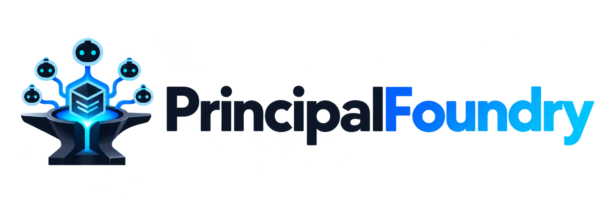
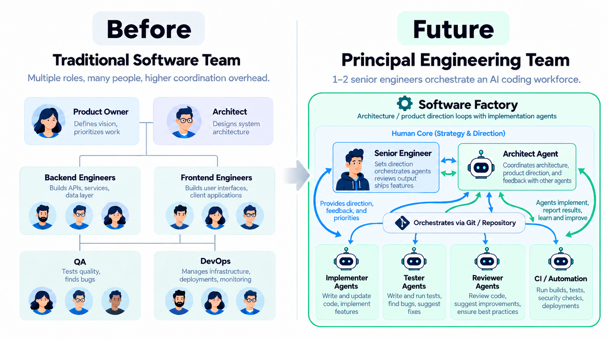

<p align="center">
  
</p>

<p align="center">
  <strong>Git-native software factories for principal engineering teams.</strong>
</p>

PrincipalFoundry is a Git-native framework and bootstrap CLI for senior-led AI software teams.

The core idea is simple: a small number of senior engineers work with a strong architect agent to define product direction and architecture, while implementation agents perform most coding, testing, verification, and routine review.

The CLI executable is `pfoundry`.

## The team model

Traditional software delivery spreads product, architecture, implementation, QA, and operations across many specialized roles. PrincipalFoundry explores a different model: one or two senior engineers retain product and engineering judgment while an architect agent continuously decomposes, reviews, and coordinates work with implementation, tester, reviewer, and automation agents.

<p align="center">
  
</p>

The human core stays intentionally small. The software factory is the execution system around it: the architect agent and execution agents work in a Git-native feedback loop, returning implementation evidence to the senior engineer instead of replacing senior engineering judgment.

## Operating model

PrincipalFoundry separates architectural judgment from implementation throughput.

```text
Senior engineer
      ↕
Architect agent
      │
      ├── product requirements
      ├── architecture
      ├── architecture decisions
      ├── task decomposition
      └── final implementation review
      │
      ▼
Git repository
      │
      ▼
Implementation agent
      │
      ├── impact analysis
      ├── coding
      ├── targeted tests
      ├── integration verification
      └── implementation evidence
      │
      ├──────────────┐
      ▼              ▼
 Tester agent    Reviewer agent
      │              │
      └──────┬───────┘
             ▼
 deterministic verification
             │
             ▼
       Architect review
             │
       accept / revise
             │
             ▼
        next small task
```

Git is the shared state, handoff mechanism, and audit trail between the architect and execution side.

## Starting a new project

A PrincipalFoundry project does **not** start with an implementation agent choosing technologies from an empty repository. Product and architecture decisions are established first with a senior engineer and the architect agent.

### 1. Create the PrincipalFoundry project

```bash
pfoundry new my-project \
  --architect chatgpt \
  --executor opencode
```

This creates the PrincipalFoundry control files and initializes the project in:

```yaml
phase: DISCOVERY
```

No implementation task is active yet.

### 2. Create or connect the Git repository

The generated project becomes the shared repository used by both the architect and executor.

The intended setup is:

```text
GitHub repository
   ├── architect agent
   └── selected executor (OpenCode / Claude Code / Codex)
```

The executor can clone the repository immediately, but it remains idle while the project is in `DISCOVERY`.

### 3. Run discovery with the architect agent

Open the repository with the strong architect model and start an interactive discovery conversation with the senior engineer.

During discovery, the architect should clarify:

- the product goal and target users;
- primary workflows and requirements;
- non-goals;
- technical and operational constraints;
- expected scale and performance;
- security and data requirements;
- deployment expectations;
- external systems and integrations;
- programming language and framework choices;
- persistence and infrastructure choices;
- major architecture boundaries;
- unresolved design questions.

Discovery is intentionally conversational. The implementation agent does not participate yet.

The working synthesis is stored in:

```text
.factory/PROJECT_BRIEF.md
```

### 4. Establish the design baseline

Once the human senior engineer approves the discovery outcome, the architect converts it into durable project documents:

```text
docs/
├── PRODUCT_SPEC.md
├── ARCHITECTURE.md
└── decisions/
    ├── INDEX.md
    └── ADR-*.md
```

These documents define what the implementation side is allowed to build against.

The architect owns major product and architecture decisions. The executor may make local implementation choices, but it must not silently replace frameworks, databases, protocols, architectural patterns, acceptance criteria, or product requirements.

### 5. Human review before implementation

The initial product specification, architecture, and important ADRs should be reviewed by the senior engineer before implementation begins.

This is a high-value approval point.

After approval, the project moves toward scaffolding and manual validation.

### 6. Architect issues the first task

The architect creates exactly one bounded implementation task in:

```text
.factory/CURRENT_TASK.md
```

The first task should normally establish only the minimum project scaffolding and verification harness required by the approved architecture.

A new project should evolve incrementally, for example:

```text
TASK-0001  project skeleton and build/test tooling
     ↓
TASK-0002  minimal runnable application
     ↓
TASK-0003  required persistence/infrastructure
     ↓
TASK-0004  first thin end-to-end product capability
     ↓
...
```

The architect should never issue a task equivalent to “implement the entire product”.

### 7. Run the implementation cycle manually

Before enabling automation, run the executor manually.

The implementation agent follows `AGENTS.md` and processes exactly one active task.

Its cycle is:

```text
CURRENT_TASK
     ↓
read architecture/spec/ADRs
     ↓
impact analysis
     ↓
tester PREFLIGHT
     ↓
baseline tests
     ↓
implementation
     ↕
targeted test feedback
     ↓
required verification gates
     ↓
tester FINAL
     ↓
independent reviewer
     ↓
deterministic final verification
     ↓
factory evidence reports
```

The executor records evidence in:

```text
.factory/
├── IMPLEMENTATION_REPORT.md
├── TESTER_REPORT.md
├── INTERNAL_REVIEW.md
└── VERIFICATION_REPORT.md
```

### 8. Architect reviews the implementation

The architect reads:

- the active task and revision;
- the implementation diff;
- implementation report;
- tester evidence;
- independent review;
- deterministic verification results;
- relevant product and architecture documents.

It then does one of three things:

```text
ACCEPT
  → close the current task
  → define the smallest useful next task

REQUEST REVISION
  → keep the same task id
  → increment the revision
  → incorporate blocking findings into CURRENT_TASK

BLOCK / ESCALATE
  → require senior-engineer product or architecture input
```

The architect should judge the actual code and evidence rather than trusting reports blindly.

## Architect cycle

Once a project is established, the architect loop is intentionally small and repeatable:

```text
current repository state
        +
PRODUCT_SPEC
        +
ARCHITECTURE / ADRs
        +
previous execution evidence
        ↓
review previous task
        ↓
accept / revise / escalate
        ↓
choose the smallest coherent next capability
        ↓
write exactly one CURRENT_TASK
        ↓
commit architect handoff
```

The architect is responsible for:

- product clarity;
- architecture;
- architecture decisions;
- task decomposition;
- task acceptance criteria;
- required verification gates;
- reviewing executor evidence;
- deciding whether work is accepted;
- choosing the next incremental task.

The architect should not normally perform the implementation itself, even if technically capable of editing the repository.

## Executor cycle

The executor is responsible for implementation throughput within the architect-defined boundaries.

It may:

- inspect and understand the repository;
- choose local implementation details;
- implement the current task;
- create or update tests;
- invoke tester and reviewer agents;
- run builds and verification;
- update evidence files.

It may not independently:

- change product requirements;
- change acceptance criteria;
- change major architecture;
- introduce major infrastructure not authorized by the task;
- start another task;
- self-approve architecture changes.

If a task requires such a decision, the executor returns `ARCHITECT_DECISION_REQUIRED`.

## Lifecycle

PrincipalFoundry projects move through explicit phases:

```text
DISCOVERY
   ↓
DESIGN
   ↓
SCAFFOLDING
   ↓
MANUAL_VALIDATION
   ↓
AUTONOMOUS
   ↕
PAUSED
```

### DISCOVERY

Human senior engineer and architect establish the product and major constraints.

### DESIGN

The architect converts discovery into the product specification, architecture, and ADRs.

### SCAFFOLDING

The implementation agent creates the initial code/project structure according to the approved architecture.

### MANUAL_VALIDATION

Architect and executor cycles are triggered manually to validate task sizing, agent behavior, tests, Git handoffs, and verification.

### AUTONOMOUS

The same architect/executor loop can now be triggered on schedules or other automation.

### PAUSED

No autonomous implementation should proceed.

## Generated project structure

A new project currently starts with:

```text
my-project/
├── AGENTS.md
│
├── docs/
│   ├── PRODUCT_SPEC.md
│   ├── ARCHITECTURE.md
│   └── decisions/
│       └── INDEX.md
│
├── .factory/
│   ├── FACTORY_STATE.md
│   ├── PROJECT_BRIEF.md
│   ├── CURRENT_TASK.md
│   ├── REVIEW.md
│   ├── IMPLEMENTATION_REPORT.md
│   ├── TESTER_REPORT.md
│   ├── INTERNAL_REVIEW.md
│   └── VERIFICATION_REPORT.md
│
└── executor-specific subagent configuration
```

Executor-specific subagents are generated only for the selected executor:

| Executor | Generated project files |
| --- | --- |
| `opencode` | `.opencode/agents/tester.md`, `.opencode/agents/reviewer.md` |
| `claude-code` | `.claude/agents/tester.md`, `.claude/agents/reviewer.md` |
| `codex` | `.codex/agents/tester.toml`, `.codex/agents/reviewer.toml` |
| `none` | No executor-specific subagent files |

The conceptual split is:

```text
docs/
= durable product and architecture knowledge

.factory/
= current PrincipalFoundry workflow state and evidence

AGENTS.md
= executor operating contract

executor-specific agent directory
= tester/reviewer definitions in the selected executor's native format
```

## Why Git?

PrincipalFoundry deliberately uses Git as the initial factory control plane.

A typical history can look like:

```text
architect: establish product and architecture baseline
architect: issue TASK-0001 r1
executor: complete TASK-0001 r1
architect: accept TASK-0001 and issue TASK-0002
executor: complete TASK-0002 r1
architect: request TASK-0002 r2
executor: complete TASK-0002 r2
```

This provides:

- atomic handoffs;
- exact code versions;
- diffs;
- audit history;
- rollback;
- branch protection;
- human review;
- CI integration;
- no additional workflow database for the initial design.

## Status

PrincipalFoundry is currently in early bootstrap.

The first milestone is a portable CLI that can initialize the PrincipalFoundry project structure and agent contracts. Planned next steps include remote GitHub project creation, stronger structured task/report contracts, lifecycle commands, and automation support.
